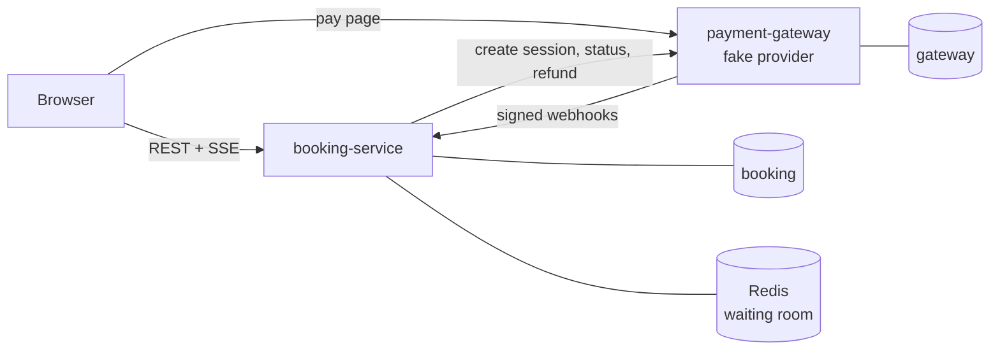

# Tix - booking movie seats

A learning-oriented movie ticket booking app. It focuses on what happens when many people want the
same seat and when payment goes wrong:

- **Seat holds with an expiry:** a seat is held for 1 minute while you pay; only one person can hold it.
- **A live seat map:** everyone watching a show sees seats change colour as they are held and booked.
- **Payment gateway webhooks:** a fake gateway (a stand-in for Stripe or Razorpay) tells us the result.
- **The late payment:** the money arrives after the hold expired and someone else took the seat.
- **A waiting room:** a flash crowd is let in a few people per second.

| Scenario                            | Expected outcome                                         |
| ----------------------------------- | -------------------------------------------------------- |
| Two people click the same seat      | Exactly one gets the hold; the other sees "seat taken"   |
| You close the tab while paying      | The hold expires after 1 minute; the seat is free again  |
| Card declined                       | The seats are released at once                           |
| Paid, but our server never heard    | A reconciliation job asks the gateway and books the seat |
| Paid after the seat went to someone | Automatic refund                                         |
| 50 people open a hot show at once   | They queue and are let in a few per second               |

Out of scope on purpose: login (you pick a username), observability, cloud deployment.

- [How to run](docs/HOW-TO-RUN.md)
- [Tasks](docs/TASKS.md)
- [Architecture](docs/architecture.md)
- [Decisions (ADRs)](docs/DECISIONS.md)
- [Interview questions](docs/INTERVIEW-QUESTIONS.md)
