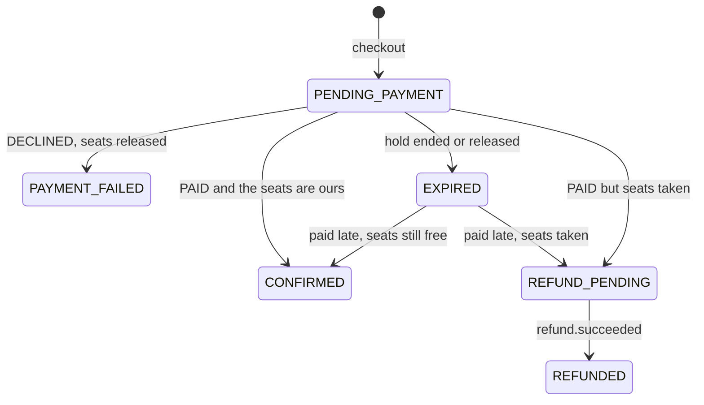

# Decisions (ADRs)

Each record says what was chosen, why, and what was rejected.

## ADR-001 - Stack

Date: 2026-11-21 - Status: Accepted

- **Services:** two NestJS 12 apps on Node 22+, run with `tsx` (no build step): `booking-service`
  and `payment-gateway`. Shared code is in `libs/kit` (`@tix/kit`); shared types in `libs/contracts`.
- **Data:** Postgres 18 with plain SQL through `pg` 8.23. Who gets a seat is decided by one SQL
  statement, so the statements and locks stay visible instead of behind an ORM.
- **Redis 6.2** with `redis` 6.3, only for the waiting room (Task 7).
- **Web:** React 19 + Vite 8 + Tailwind 4.
- **Users:** no login. The caller names itself in an `X-User` header; the UI asks for a name once
  per browser tab, so two tabs can be two people racing for a seat.
- **Out of scope:** login, observability, cloud or Kubernetes deployment.

Rejected:

- Prisma or TypeORM: they hide the exact `UPDATE ... WHERE` that decides the race.
- WebSocket for the live map: updates flow one way, from server to browser; SSE is plain HTTP,
  reconnects by itself and goes through the Vite proxy unchanged (ADR in Task 3).

## ADR-002 - The payment gateway is a separate service with its own database

Date: 2026-11-21 - Status: Accepted

In real life the gateway belongs to another company. We only reach it over HTTP, and it only reaches
us through webhooks. Making it a separate process with its own database (`gateway`, role
`gateway_svc`, `CONNECT` revoked from `PUBLIC`) keeps that honest: the booking service cannot peek
at a payment row to find out what happened, which is exactly the situation the webhook and
reconciliation tasks are about.

Rejected: a gateway module inside the booking service - one transaction could then book the seat and
record the payment together, and none of the failure cases would exist.

## ADR-003 - One Postgres and one Redis container

Date: 2026-11-21 - Status: Accepted

One Postgres container with two databases and two roles (created by
`infra/postgres/init/01-databases.sql`, which runs only on an empty volume). Redis runs without
persistence: the waiting room can be rebuilt by people joining again, and the seat state never lives
in Redis. The passwords in `.env.sample` are local-container values, not secrets.

Rejected: one Postgres per service - closer to production, twice the memory for the same lesson.

## ADR-004 - Health checks name the failing dependency

Date: 2026-11-21 - Status: Accepted

`GET /health` returns 200 with one entry per dependency, or 503 with the same body, so the Status
page can say which one is down. Each probe has a 3-second timeout. Redis is checked only when
`REDIS_URL` is set (the gateway has none). The Redis client connects on first use and does not
queue commands while disconnected (`disableOfflineQueue`), so a stopped Redis gives an error at once
instead of a timeout.

Rejected: Terminus (`@nestjs/terminus`) - one more dependency for two probes.

## ADR-005 - One row per seat per show

Date: 2026-11-21 - Status: Accepted

`show_seats (show_id, seat_no)` holds the status of every seat of every show, copied from the
screen's layout (`screen_seats`) when the show is created. This is the row two buyers fight over:
"who gets A7 at 18:00" becomes "whose `UPDATE` changes this one row", which Postgres decides with a
row lock. The price is copied too, so a later price change does not alter a seat someone is paying
for.

Rejected:

- A counter per show (`seats_left`), as in the e-commerce stock: people pick a specific seat, not
  "any seat".
- Seats only in `bookings`, free meaning "no booking row": a hold would then be an insert that has to
  be checked against expired rows, and the seat map needs a join with a `NOT EXISTS` for every seat.

## ADR-006 - A hold is one conditional UPDATE, all or nothing

Date: 2026-11-21 - Status: Accepted

When two people press "Hold" on A7 in the same millisecond, the database decides:

```sql
UPDATE show_seats SET status = 'HELD', hold_id = $3, hold_expires_at = $4
WHERE show_id = $1 AND seat_no = ANY($2)
  AND (status = 'AVAILABLE' OR (status = 'HELD' AND hold_expires_at <= now()))
RETURNING seat_no;
```

The second `UPDATE` waits for the first one's row lock, then re-checks the `WHERE` on the new row
version and matches nothing. If fewer rows come back than seats were asked for, the transaction
(including the new `holds` row) is rolled back and the caller gets 409 `SEATS_UNAVAILABLE` with the
seats that were not free. The other seats are never held "half way".

The `holdMode` switch shows the alternatives side by side:

| Mode          | How                                                       | Result                                                  |
| ------------- | --------------------------------------------------------- | ------------------------------------------------------- |
| `atomic`      | the statement above                                       | one winner                                              |
| `pessimistic` | `SELECT ... ORDER BY seat_no FOR UPDATE`, check, `UPDATE` | one winner, one more round trip                         |
| `naive`       | `SELECT` without a lock, pause, unconditional `UPDATE`    | everyone is told "yours"; the last writer really has it |

Seats are always locked in seat-number order (sorted request, `ORDER BY seat_no`), so overlapping
multi-seat holds wait for each other instead of deadlocking: 40 overlapping 3-seat holds gave no
deadlock. A deadlock would still be answered with 409 `DEADLOCK` and `retryable: true`.

Rejected:

- `SERIALIZABLE`: also correct, but the loser gets a serialization failure to retry instead of a
  clear "seat taken".
- A lock in Redis (`SET NX`) in front of the database: faster for very hot shows, but then two
  systems must agree; Postgres is the source of truth here and is fast enough for one seat row.
- A version column (optimistic locking): the conditional `UPDATE` already is the optimistic check,
  without an extra column.

## ADR-007 - Expired means free at once; the sweeper only tidies

Date: 2026-11-21 - Status: Accepted

A hold lasts `holdTtlMs` (60 000 ms by default, so the expiry is easy to watch). Every read and
every hold treats `status = 'HELD' AND hold_expires_at <= now()` as free (`SEAT_IS_FREE` in
`seat-sql.ts`), so a seat is back on sale the moment its hold expires, without waiting for a job.

A sweeper on every instance runs each second: it marks due holds `EXPIRED`
(`FOR UPDATE SKIP LOCKED`, so two instances never take the same hold) and frees only seats that
still point at that hold. A seat someone else already took after the expiry keeps its new hold.

Rejected:

- Sweeper only: a seat would look taken for up to a second after its hold ended, and correctness
  would depend on a background job running.
- Redis keys with a TTL as the hold: an expired key vanishes without anyone telling the seat map,
  and the booking would need both stores to agree.

## ADR-008 - Live seat map: SSE out, Postgres LISTEN/NOTIFY between instances

Date: 2026-11-21 - Status: Accepted

**Browser:** `GET /shows/:id/events` is a Server-Sent Events stream. The first event is a full
`snapshot`; after that, `seats` events carry only the seats that changed. The browser's
`EventSource` reconnects by itself, and every new connection starts with a snapshot, so a viewer
never has to replay missed events (no `Last-Event-ID` bookkeeping).

**Between instances:** a hold made on :7001 must reach someone watching through :7011. Every
transaction that changes a seat calls `pg_notify('seat_changes', {showId, seats})`. Postgres
delivers a notification only when that transaction commits, so a hold that is rolled back (409) is
never announced, and the announcement can never get ahead of the data. Each instance keeps one
dedicated connection with `LISTEN seat_changes`, reads the changed seats once per notification and
pushes them to its own viewers.

- Notifications sent while an instance is not listening are lost. After a reconnect the instance
  sends every open map a fresh snapshot (verified with `pg_terminate_backend`).
- A seat whose hold expires changes state without a write. It is announced when the sweeper
  (ADR-007) writes, up to a second later.
- The seat map is the only live view; show lists and the Lab still poll.

Rejected:

- WebSocket: two-way, needs its own upgrade path through the proxy, and the browser sends nothing
  on this channel.
- Polling the seat map every second: 30 viewers make 30 queries a second for a map that rarely
  changes, and changes still show up late.
- Redis pub/sub or Kafka between instances: one more system to keep in step with the database;
  `NOTIFY` is transactional with the seat change for free.
- Sending the change from application code after `COMMIT`: a crash between the two loses the
  event, and a send before `COMMIT` can announce a change that is then rolled back.

## ADR-009 - The fake gateway behaves like a real one

Date: 2026-11-21 - Status: Accepted

The gateway copies the parts of Stripe Checkout or Razorpay that cause trouble for a merchant:

- **Sessions with an idempotency key.** The merchant creates a payment session with an
  `Idempotency-Key`. A retry with the same key and body returns the first session (200,
  `Idempotent-Replayed: true`); the same key with another body is 422. A merchant whose request
  timed out can therefore simply send it again.
- **A hosted pay page.** The customer pays on the gateway's page, not the merchant's. Afterwards the
  browser is redirected to `returnUrl?session=..&status=..`. Anyone can type that URL, so the
  merchant must treat it as a hint and confirm with the gateway (Task 5).
- **Expiry.** A session ends at `expiresAt` (the merchant sets it). A payment started before then
  may finish after it (`slowPayMs`): banks answer late, and that is the late-payment case.
- **Webhooks from an outbox.** The event row is inserted in the transaction that changes the
  session's status, so there is never a status change without its event, or the reverse. A
  deliverer claims due events with a 30-second lease (committed before the HTTP call), posts them
  and retries with backoff. Delivery is **at least once**: the merchant must accept duplicates.
- **Signatures.** `Gateway-Signature: t=<unix>,v1=<hex HMAC-SHA256(secret, "t.body")>`. The
  receiver checks it in constant time and refuses signatures older than 5 minutes (replays).
  The shared secret is `WEBHOOK_SECRET` in both `.env.sample` files: a local value only.
- **Status API and refunds.** `GET /sessions/:id` answers "what happened to this payment?"; a refund
  takes its own idempotency key and happens once.

Known gap: a gateway crash during `slowPayMs` leaves the session `PROCESSING`. A real gateway would
resolve it with the bank; this one does not.

Rejected:

- Delivering webhooks straight from the request handler: a crash after the commit loses the event.
- A mock that answers instantly and always succeeds: none of the failure cases would happen.

## ADR-010 - Checkout: confirm exactly once, whoever brings the news

Date: 2026-11-21 - Status: Accepted

A payment result can reach the booking service three ways: the **webhook**, the customer's
**return** to the shop, and (Task 6) **reconciliation**. Any of them may come twice, late, or at
the same moment on two instances. All three call one function, `settle`, which:

1. locks the hold, then the booking row (`FOR UPDATE`), so concurrent callers queue up;
2. reads the booking's status and does nothing if the result was already applied ("already
   handled" in the timeline);
3. applies the result and writes the timeline entry in the same transaction.

Webhooks also go through `webhook_inbox` (event id primary key), inserted in that transaction, so
a duplicate delivery is acknowledged with 200 and ignored. The return never trusts
`?status=PAID` in the URL: anyone can type it. `POST /bookings/:id/verify` asks the gateway's status
API instead.

**Checkout** is idempotent: one booking per hold (unique `hold_id`), and the gateway session is
created with the key `booking-<id>` after the booking row has committed. If the gateway is down the
customer gets 502 and the booking waits without a session; pressing Pay again sends the same key
and gets one session, never two.

**The payment window** ends `paymentMarginMs` (10 s) before the hold. A customer who pays at the last
second still has the hold while the bank answers. If the bank answers after the hold anyway
(`slowPayMs`), confirm still books the seats when they are free; only if someone else took them is
the booking `REFUND_PENDING` (Task 6 refunds it).

**Failure is compensated at once:** a declined card frees the seats immediately instead of making
everyone wait for the hold to expire.



Rejected:

- Trusting the redirect: a free ticket for anyone who edits the URL.
- Calling the gateway inside the checkout transaction: a slow gateway would hold the hold's row lock
  for seconds, and a timeout would leave us unsure whether a session exists.
- Webhook only, no verify on return: when a webhook is late the customer stares at "pending"
  although they paid.
- A "processed" flag on the booking instead of an inbox: it cannot tell a duplicate of event A
  from a new event B about the same booking (for example `refund.succeeded` after
  `payment.succeeded`).

## ADR-011 - Recovery: reconcile with the gateway, refund what is owed

Date: 2026-11-21 - Status: Accepted

Webhooks and returns are fast but can both fail: the webhook is lost, our endpoint is down, the
process crashes, the customer closes the tab. Two background jobs on every instance make sure every
booking still ends in a final state:

- **Reconciliation.** Bookings that are `PENDING_PAYMENT` or `EXPIRED` and older than
  `reconcileAfterMs` (15 s, so webhooks usually win) are claimed with `FOR UPDATE SKIP LOCKED`.
  The claim also pushes `next_check_at` back (2, 4, 8, 16, then every 30 s), so two instances never
  ask about the same booking at once and a slow gateway is not hammered. The job asks
  `GET /sessions/:id`; the answer goes through the same `settle` as webhooks (ADR-010). When the
  answer is final (`PAID`, `DECLINED`, `EXPIRED`, `REFUNDED`), `settled_at` stops further checks.
- **Lost session ids.** If we crashed after the gateway created a session and before we stored its
  id, the booking has no `session_id`. Reconciliation looks the session up by `merchantRef`, which
  is the booking id. Retrying checkout also works: the idempotency key returns the same session.
- **Refunds.** A booking paid after its seats went to someone else is `REFUND_PENDING`. The refund job
  calls `POST /sessions/:id/refund` with the key `refund-<booking id>`, so retries refund once, and
  `settle` records `REFUNDED`. Refunding is automatic: the customer did nothing wrong.

**Crash points** (`crashPoint`) call `process.exit(1)` at the two moments that matter: after the
gateway created a session, and when a webhook arrives before it is applied. Nothing half-done is
committed, because each step is one transaction. **`webhooksDown`** answers 503, which the gateway
retries.

**Consistency report.** `GET /admin/consistency` runs invariant queries: no seat `BOOKED` without a
`CONFIRMED` booking, no confirmed booking missing a seat, no seat in two confirmed bookings. Warnings
list naive double holds, refunds still owed and checkouts waiting over a minute.

Rejected:

- Expiring the booking as "failed" when no webhook comes: the customer may have paid; only the
  gateway knows.
- Asking the gateway about every pending booking at once on each tick: with a backoff per booking
  the load stays flat when the gateway is slow.
- Manual refunds: a person must notice first, and the customer waits for their money.
