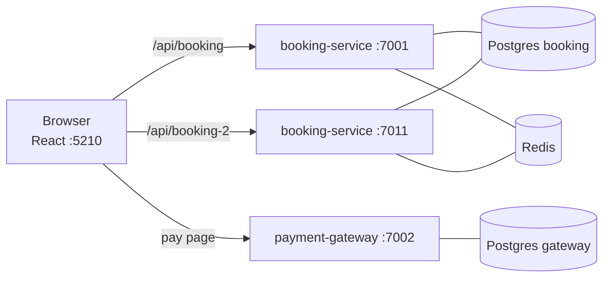
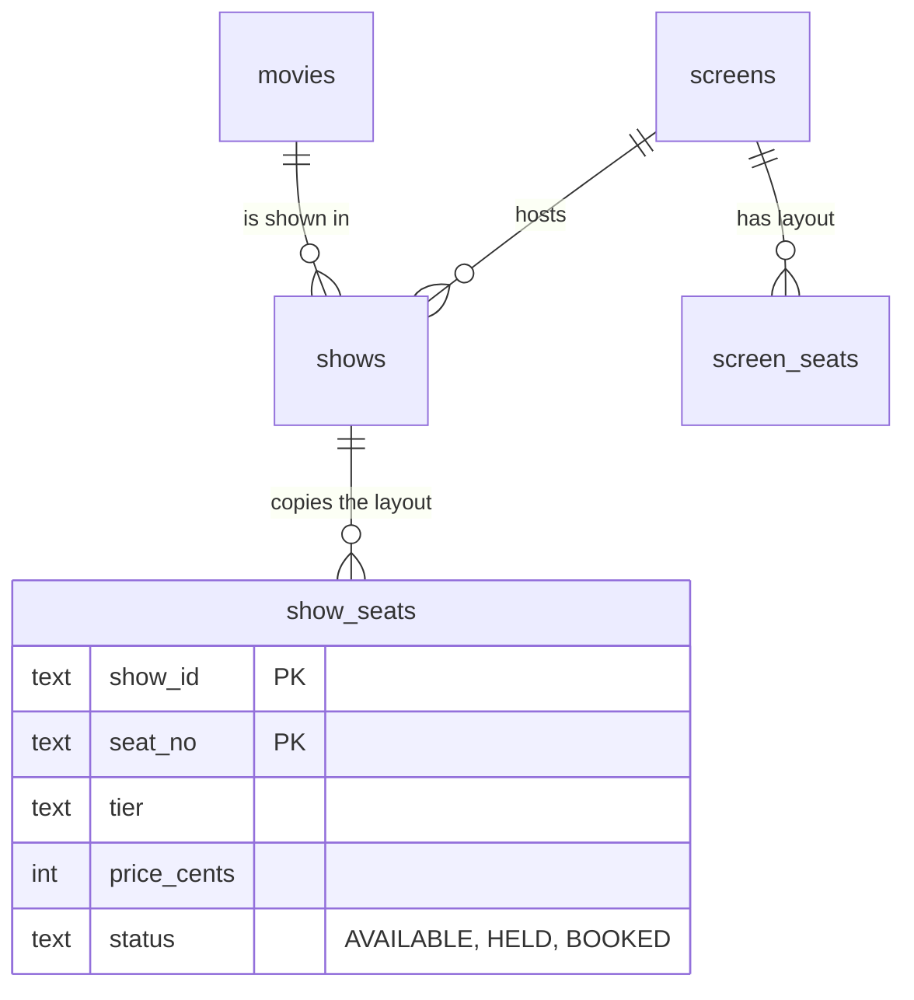

# Architecture

## Components

- **booking-service** owns movies, shows, seats, holds and bookings. Two instances can run against
  the same database to show that the design does not depend on one process.
- **payment-gateway** is a fake payment provider with its own database (ADR-002).
- **web** talks to the services through the Vite dev proxy: `/api/<service>/...`.

## Data

A show copies its screen's seats into `show_seats` (ADR-005): one row per seat per show is what
concurrent buyers compete for.

This document grows with each task.
