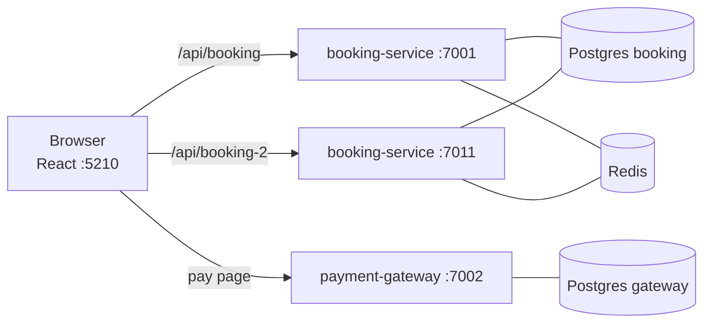
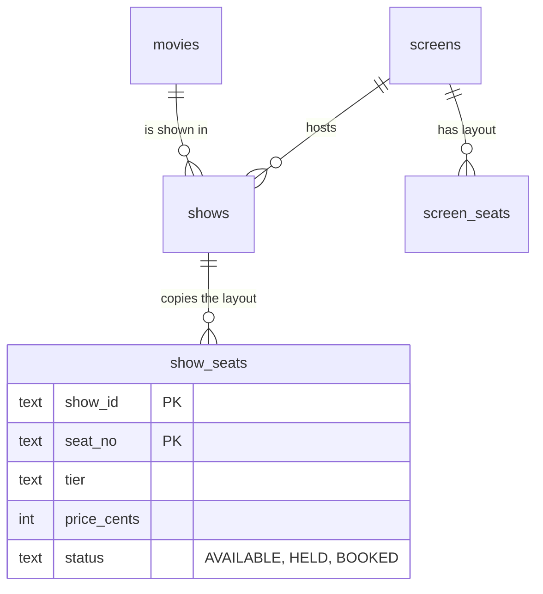
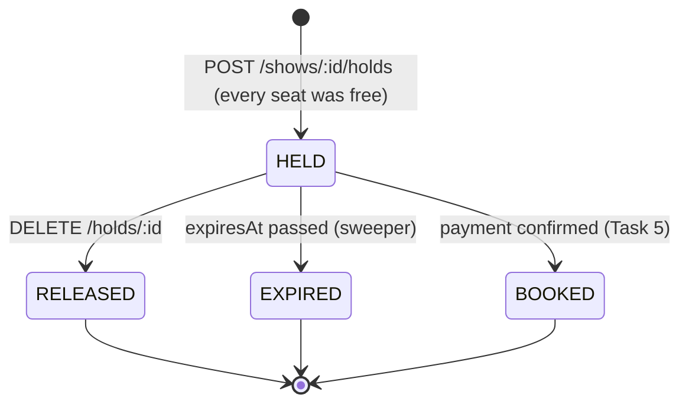
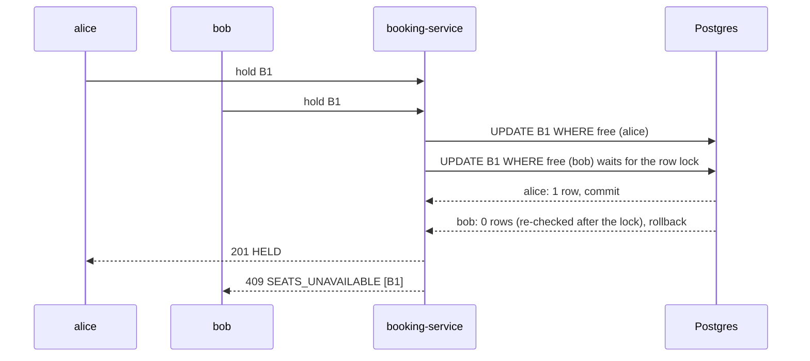
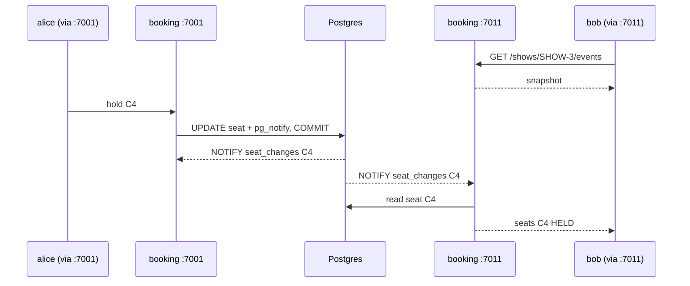
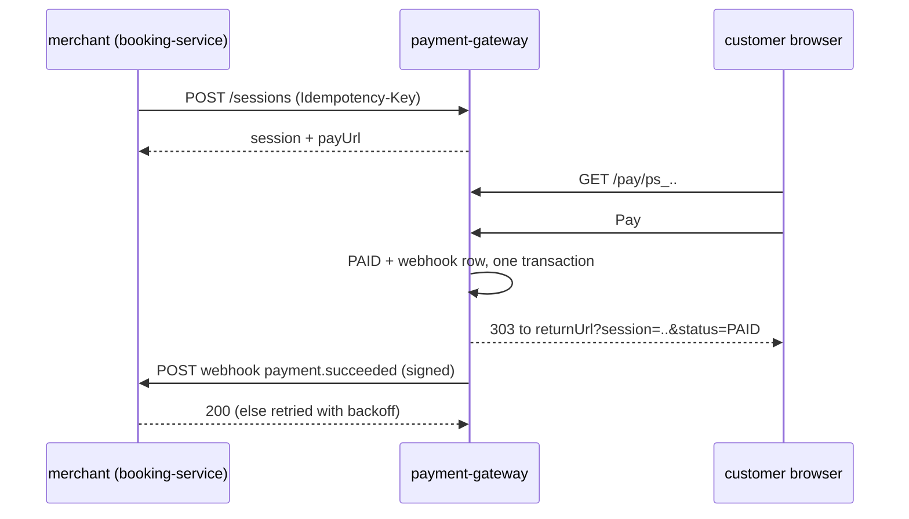

# Architecture

## Components

- **booking-service** owns movies, shows, seats, holds and bookings. Two instances can run against
  the same database to show that the design does not depend on one process.
- **payment-gateway** is a fake payment provider with its own database (ADR-002).
- **web** talks to the services through the Vite dev proxy: `/api/<service>/...`.

## Data

A show copies its screen's seats into `show_seats` (ADR-005): one row per seat per show is what
concurrent buyers compete for.

This document grows with each task.

## Holds

A hold keeps seats for one person while they pay. Two people asking for the same seat at once are
decided by one conditional `UPDATE` (ADR-006); an expired hold frees its seats at once (ADR-007).

## Live seat map

Every seat change is announced with `pg_notify` inside its own transaction; each booking instance
listens and streams the changed seats to its viewers over SSE (ADR-008).

## Payment gateway

The gateway is a separate service with its own database (ADR-002). It records each status change
together with a webhook row, and a deliverer sends the webhooks until they are acknowledged (ADR-009).

